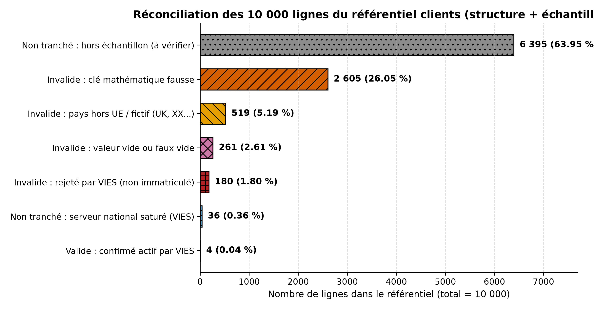
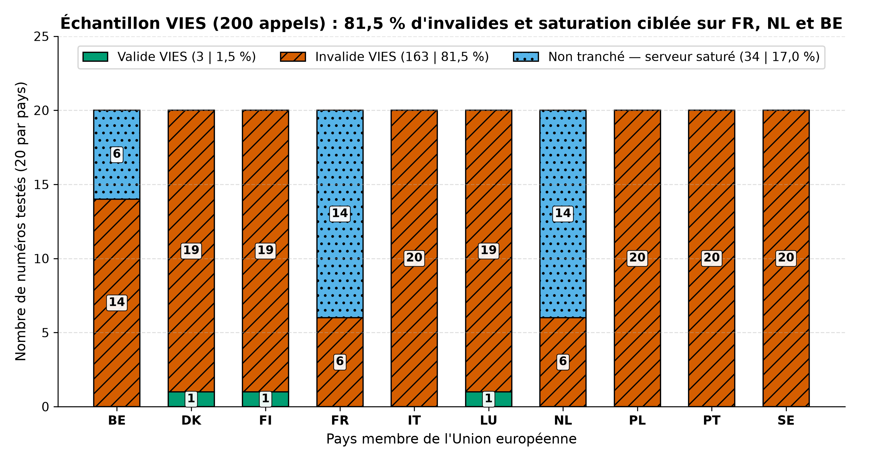
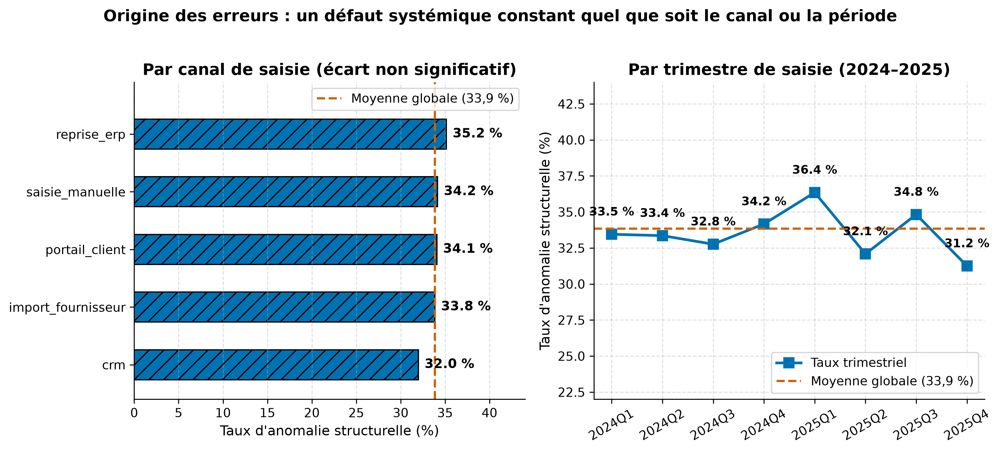

# Note de synthèse — Audit du référentiel clients de TVA intracommunautaire

**À l'attention de :** Direction Administrative et Financière (DAF) — Meridian Distribution  
**Objet :** État des lieux du référentiel TVA (10 000 comptes), analyse des risques fiscaux et plan d'action  

---

## 1. Synthèse exécutive : où en sont nos 10 000 numéros ?

À la suite du redressement fiscal de mars, l'audit complet des **10 000 lignes** du référentiel clients (complété par une vérification par sondage de **200 numéros** auprès du registre officiel européen **VIES**) révèle une exposition fiscale majeure : **moins de 2 % des numéros conformes en apparence sont réellement actifs**.

| Statut d'audit (référentiel complet) | Lignes CRM | Part (%) | Dont doublons | Situation fiscale & action immédiate |
| :--- | :---: | :---: | :---: | :--- |
| **1. Valides** (confirmés actifs par VIES) | **4** | **0,04 %** | 1 | Facturation HT autorisée (preuve archivée) |
| **2. Invalides** (prouvés) | **3 565** | **35,65 %** | 142 | **Interdiction de facturer HT** (basculer en TTC) |
| *— dont rejetés avant appel VIES (structure/clé)* | *3 385* | *33,85 %* | *125* | *2 605 clés fausses, 519 pays hors UE, 261 vides* |
| *— dont rejetés par l'API VIES (non immatriculés)* | *180* | *1,80 %* | *17* | *Format exact mais numéro inexistant ou radié* |
| **3. Non tranchés** (statut VIES en attente) | **6 431** | **64,31 %** | 295 | **Gel de l'autoliquidation HT** jusqu'à preuve VIES |
| *— dont hors échantillon (à interroger)* | *6 395* | *63,95 %* | *293* | *6 102 numéros uniques structurellement conformes* |
| *— dont indisponibilité temporaire serveur VIES* | *36* | *0,36 %* | *2* | *Saturation nationale (FR, NL, BE) — à relancer* |
| **Total référentiel clients** | **10 000** | **100,00 %** | **438** | **37 % d'appels API économisés par le nettoyage** |

---

## 2. Enseignements clés de l'analyse

* **Un filtre préalable indispensable mais insuffisant :** le nettoyage des bruits de saisie, la suppression des **438 doublons** et le contrôle mathématique des clés nationales écartent d'emblée **3 698 lignes inutiles** (économisant **37 % d'appels** au service européen). En revanche, un numéro mathématiquement valide n'offre **aucune garantie fiscale** : sur les **200 numéros conformes** testés sur VIES, **163 (81,5 %)** ont été rejetés comme inexistants ou radiés.
* **Portée statistique de l'échantillon :** seuls **3 numéros sur 200 (1,50 %)** sont confirmés actifs (soit **1,81 %** des 166 numéros ayant obtenu une réponse définitive, avec un intervalle de confiance à 95 % compris entre **0,00 % et 3,83 %**). Cet échantillon prouve l'ampleur critique de l'obsolescence de la base, mais ne permet pas de statuer individuellement sur les **6 102 numéros uniques** non encore interrogés.
* **Une origine systémique et non ponctuelle :** le taux d'anomalie structurelle (**33,85 %**) est quasi identique sur les **5 canaux d'entrée** (de **32,0 %** sur le CRM à **35,2 %** sur la reprise ERP) et reste stable sur tous les **trimestres 2024–2025** (**31,2 % à 36,4 %**). Le défaut provient de l'**absence généralisée de contrôle de saisie** à l'ouverture des comptes clients.

---

## 3. Recommandations opérationnelles pour la facturation et l'IT

1. **Règle de conduite immédiate sur les 6 431 lignes « non tranchées » (principe de précaution) :**  
   Aucun client classé *non tranché* (hors échantillon ou bloqué par une saturation serveur `MS_MAX_CONCURRENT_REQ`) ne doit bénéficier d'une facturation hors taxe par défaut. Toute facture intracommunautaire doit être émise **TTC** tant que le service VIES n'a pas retourné un statut actif. En parallèle, lancer en priorité l'audit des **6 102 numéros uniques** restants (en commençant par les clients actifs à fort chiffre d'affaires) grâce au script automatisé en mode tourniquet.
2. **Durée de validité d'un verdict VIES et traçabilité fiscale :**  
   Une validation VIES est un **instantané administratif** : une entreprise peut cesser son activité ou perdre son assujettissement à tout moment. Tout numéro doit être **revérifié systématiquement à l'émission de chaque facture HT** (ou au minimum **tous les 30 jours** pour les clients récurrents), en archivant la date officielle de réponse (`requestDate`) dans l'ERP comme preuve opposable en cas de contrôle fiscal.
3. **Verrouillage à la source dans les outils de saisie :**  
   Intégrer immédiatement le contrôle de format et de clé mathématique dans le CRM, le portail client et les imports fournisseurs afin de bloquer toute création de fiche comportant un numéro vide, hors UE ou mathématiquement faux.